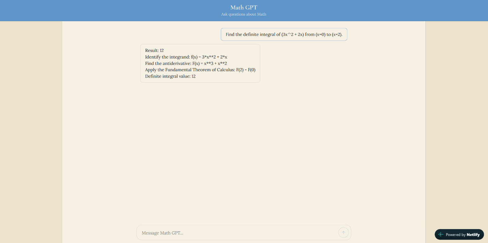

# Math GPT / RAG Data Parser

An AI-powered math solving and routing engine. Instead of letting LLMs hallucinate calculations, this system uses Claude to classify math queries into structured schemas and delegates the computation to a deterministic symbolic math engine (**SymPy** and Python arithmetic solvers).

🌐 **Live Demo:** [https://mathllm.netlify.app/](https://mathllm.netlify.app/)

---

## 📸 Preview



---

## ⚡ Key Features

- **Deterministic & Auditable Computation**: LLMs classify and structure problems; real math solvers evaluate answers and step-by-step solutions without hallucinations.
- **Calculus Operations**: Solves symbolic derivatives and both definite/indefinite integrals with step-by-step explanations via SymPy.
- **Arithmetic & Mixed Expressions**: Handles standard operations along with complex expressions with parentheses and operator precedence (e.g. `2 + 3 * (4 - 1)`).
- **FastAPI Backend**: Clean REST API endpoints with Pydantic validation and CORS support.
- **Modern Web Interface**: Clean chat UI built with React, Vite, and TypeScript.

---

## 🚀 Running Locally

To run this project locally, you will need to run the **Backend API** (Python / FastAPI) and the **Frontend** (React / Vite).

> **Note on Anthropic API Key:**  
> Running the backend requires your own Claude API key from Anthropic.

### 1. Clone the Repository

```bash
git clone https://github.com/BambooS99/RAG-data-parser.git
cd RAG-data-parser
```

### 2. Backend Setup (FastAPI)

1. **Create and activate a virtual environment:**
   ```bash
   # Windows (PowerShell)
   python -m venv .venv
   .\.venv\Scripts\Activate.ps1

   # macOS / Linux
   python3 -m venv .venv
   source .venv/bin/activate
   ```

2. **Install Python dependencies:**
   ```bash
   pip install -r requirements.txt
   ```

3. **Configure Environment Variables:**
   Create a `.env` file in the root directory:
   ```env
   # Plug your own Anthropic Claude API key here
   ANTHROPIC_API_KEY=your_claude_api_key_here
   FRONTEND_ORIGIN=http://localhost:5173
   ```

4. **Start the FastAPI backend:**
   ```bash
   uvicorn api.main:app --reload
   ```
   The API will be live at `http://127.0.0.1:8000`. You can test endpoints via Swagger docs at `http://127.0.0.1:8000/docs`.

---

### 3. Frontend Setup (React / Vite)

1. **Install Node dependencies:**
   ```bash
   npm install
   ```

2. **Configure Frontend Environment (Optional):**
   By default, Vite points to `http://127.0.0.1:8000`. If you wish to set it explicitly, create `.env.local`:
   ```env
   VITE_API_URL=http://127.0.0.1:8000
   ```

3. **Start the development server:**
   ```bash
   npm run dev
   ```
   Open your browser and navigate to `http://localhost:5173`.

---

## 🧪 Running Tests

To run the backend test suite:

```bash
python -m unittest discover api/tests
```
